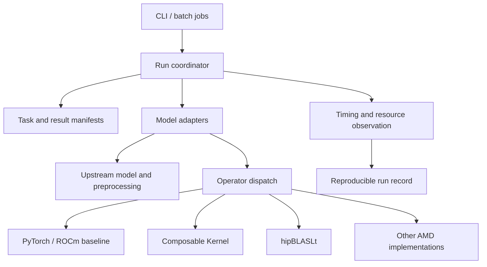

# FireProt architecture

Status: partially implemented, 2026-10-02. The Protenix measurement, validation, registry, runtime bootstrap, BLAS policy, and first two gfx90a operator paths are implemented. The full cross-model adapter API and additional model adapters remain proposed interfaces.

## Implementation snapshot

The current implementation provides a model-neutral operation registry under `fireprot/ops`, AMD backends under `fireprot/backends/amd`, a Protenix bootstrap under `fireprot/adapters/protenix`, numerical validation under `fireprot/validation`, and reproducible Protenix tooling under `benchmarks/protenix`. The independent Protenix checkout exposes `fireprot` choices for triangle multiplication and triangle attention while retaining its upstream torch defaults.

Two exact FP32 inference signatures are promoted on gfx90a for the measured 124-token Mini workload. Triangle multiplication replaces the upstream chunked inference path with a direct update while preserving in-place aliasing. Triangle attention uses PyTorch ROCm memory-efficient SDPA, makes the Protenix head-last triangle bias contiguous, and limits its outer batch workspace to 64 rows. The registry falls back to native behavior for every unmatched signature.

The complete adapter contract described below has not yet been implemented as a stable public API. The current Protenix bootstrap is the first integration seam from which that API will be extracted after a second model is studied.

## 1. Scope

FireProt targets protein structure **inference on AMD GPUs**. It should reproduce upstream model semantics and reduce latency or resource use only where measurements support an optimization. Model adapters own model-specific scientific behavior. The framework owns configuration, resources, execution, observation, and validation. Optimized operators must be independently selectable, reversible, and testable.

Compatibility is a capability matrix, not a promise that every model accepts the same inputs, weights, or accuracy metrics. Protenix, OpenFold, and ESMFold have different preprocessing and inference paths. AtlasFold's actual source API must be examined when its adapter is implemented; its name alone does not define a contract.

## 2. Layers and dependency direction



Framework entry points call adapters; adapters call upstream implementations. Operator implementations must not depend on model names. Shared data structures describe tasks, artifacts, capabilities, and timing, without forcing model-internal feature tensors into a cross-model ABI.

## 3. Proposed repository boundaries

```text
fireprot/
  api/             # Versioned task, capability, result, and error contracts
  runtime/         # Devices, weights, cache, coordination, timing, and logs
  adapters/        # protenix/, openfold/, esmfold/, atlasfold/
  ops/             # Stable operator entry points, dispatch, PyTorch baselines
  backends/        # CK, hipBLASLt, other ROCm kernels, and build integration
  validation/      # Numerical, structural, performance, reproducibility tools
tests/
  contracts/       # Adapter and operator contracts
  numerical/       # Dtypes, shapes, masks, and edge conditions
  integration/     # Per-model end-to-end smoke tests
benchmarks/        # Fixed inputs and measurement programs; raw results excluded
```

Keep `Protenix/` as an independent upstream checkout. Other upstream implementations should follow the same independent-source approach. Keep adapters and local patches in the top-level repository. When an upstream edit is unavoidable, record the baseline commit, patch, and license. Do not copy upstream source into the shared core.

## 4. Model adapter contract

Each adapter should expose an identifier, version, supported upstream version range, `capabilities()`, `validate(request)`, `prepare(request)`, `load(weights, device)`, `predict(prepared, run_config)`, and `collect(raw_output)`. Implementations may combine internal stages, but must report which stages were actually measured. The common entry point must not assume that every model has MSA, templates, diffusion, recycling, or the same confidence head.

A task manifest should record input paths and hashes, model and weight identity, model-specific parameters, random seeds, dtype, device, requested operator backend, output directory, and cache policy. Capabilities should describe supported molecular inputs, chain counts, MSA/template/ligand features, dtypes, device requirements, and replaceable operator sets. Reject unsupported combinations before execution with a clear error.

A result manifest should record coordinate artifacts and formats, native confidence artifacts, stage timings, peak GPU memory, operator implementations actually used, fallback reasons, input/weight/code versions, and the runtime environment. Preserve native model results. Compare models only with explicitly defined common metrics; native confidence scores are not automatically comparable.

`prepare` may return a model-private opaque object or traceable files. Only genuinely shared metadata, such as sequences, chain identities, and MSA/template provenance, belongs in the common schema. ESMFold need not imitate Protenix's feature dictionary.

## 5. AMD operator layer

Replace operators at explicit PyTorch call boundaries. Start with a PyTorch/ROCm reference and fallback for each operator; then evaluate CK, hipBLASLt, or custom HIP implementations. Select targets from real profiling and remeasure whenever the model, shape, dtype, or hardware bucket changes.

Each operator entry point must define its mathematical expression, tensor layouts and strides, shape range, dtype, accumulation precision, mask and broadcasting semantics, determinism requirement, workspace, output format, and error tolerance. Dispatch depends on these capabilities and device properties. Record the selected backend explicitly; never silently change model semantics. Validate each GPU architecture, ROCm version, and library version separately.

Measured Mini-default 124-token profiles establish Pairformer as the dominant stage for the current development bucket. They do not establish the hotspot mix for Base weights, long sequences, complexes, ligands, or other model families. Remaining candidates include linear layers/GEMM, LayerNorm, fused residual operations, layout copies, and repeated diffusion matrix operations. Evaluate hipBLASLt for supported matrix multiplication paths and CK for tensor kernels worth specializing. Decide from shape distributions, end-to-end benefit, compile cost, numerical error, and memory use.

The operator library may contain many implementations, but should expose a small, stable public interface. Build benchmark records indexed by operator, shape/layout/dtype, GPU architecture, and backend. Enable an optimization only for validated combinations; otherwise fall back to PyTorch. Record operator package versions and build flags.

## 6. Validation and performance

1. **Contract validation:** input capability checks, missing-weight/dependency behavior, and complete result manifests.
2. **Numerical validation:** compare reference and optimized operators at fixed inputs and random states. Include non-contiguous tensors, boundary shapes, masks, multiple dtypes, and extreme values. Define tolerances per operator.
3. **Model validation:** compare end-to-end runs with the same model, weights, input, cycle/recycle count, steps, samples, seed, preprocessing, and cache conditions. Record coordinate and native-confidence differences. For stochastic models, use repeated-run distributions instead of promising bitwise identity.
4. **Performance validation:** report cold and warm start, preprocessing/ESM, model load, major model stages, end-to-end latency, and peak GPU memory separately. Synchronize GPU timing; record warmup, repetitions, concurrency, GPU model, and ROCm/PyTorch/library versions.
5. **Dataset limits:** the current eight short-chain examples are a development set. They do not establish generalization or long-chain throughput. Structural metrics must use `coordinates[mask]` in `gt_mapping.npz`. Add untouched evaluation cases and long-chain/complex benchmarks.

## 7. Implementation stages

| Stage | Status | Deliverable and acceptance |
| --- | --- | --- |
| A: Protenix baseline | Implemented for the initial Mini/124-token matrix | Repeated timing on fixed configurations and hardware; manifests include versions, cache state, stage timings, and peak memory; compare against the current native CLI |
| B: Minimal framework | Partially implemented | Registry, AMD backend boundary, Protenix bootstrap, validation, and measurement exist; the stable task/result coordinator API remains to be extracted |
| C: First AMD operator | Implemented for exact gfx90a FP32 signatures | Triangle multiplication and triangle attention have capability checks, tests, native fallback, numerical gates, and measured end-to-end impact |
| D: Additional models | Not started | Add OpenFold, ESMFold, and AtlasFold one at a time; each has capability declarations, a native baseline, end-to-end smoke, and result manifests |
| E: Operator expansion | Exploratory | The BLAS matrix and residual profile exist; extend CK/hipBLASLt/HIP implementations only where cross-model shapes and repeated measurements justify them |

Preserve source, weight, and input provenance throughout. Establish correctness before reporting speed. Stage D's order can change with source and weight availability or user priorities.
