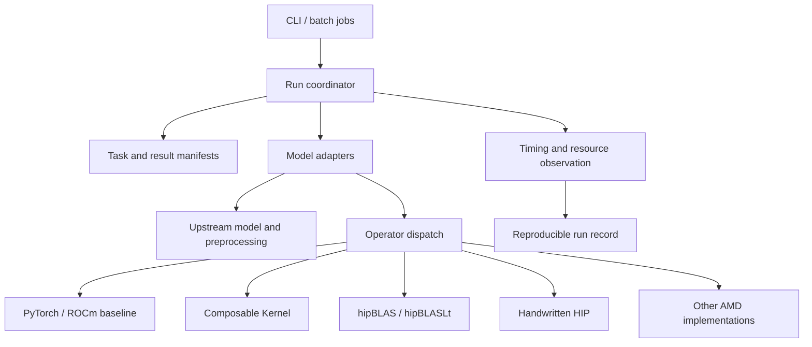

# FireProt architecture

Status: partially implemented, 2026-10-03. The Protenix measurement, validation, registry, runtime bootstrap, BLAS policy, short-sequence gfx90a operator paths, exact 1,000-token triangle, LayerNorm, and transition paths, and continuous benchmark isolation checks are implemented. The full cross-model adapter API and additional model adapters remain proposed interfaces.

## Implementation snapshot

The current implementation provides a model-neutral operation registry under `fireprot/ops`, AMD backends under `fireprot/backends/amd`, a Protenix bootstrap under `fireprot/adapters/protenix`, numerical validation under `fireprot/validation`, and reproducible Protenix tooling under `benchmarks/protenix`. The independent Protenix checkout exposes `fireprot` choices for triangle multiplication and triangle attention while retaining its upstream torch defaults.

FP32 inference paths are promoted on gfx90a for measured 124- and exact 1,000-token Mini workloads. Short triangle multiplication replaces the upstream chunked inference path with a direct update while preserving in-place aliasing. Long triangle multiplication normalizes once, uses HIP sigmoid-and-pack kernels to produce contiguous channel-first projections, contracts them with library BMM, and fuses unpacking with output LayerNorm. The previous chunked contraction and its fusion callbacks remain as a diagnostic fallback. Triangle attention uses PyTorch ROCm memory-efficient SDPA, makes the Protenix head-last triangle bias contiguous, limits its outer batch workspace to 64 rows, and omits an implicit all-ones pair mask. Handwritten HIP kernels specialize contiguous 128-wide pair LayerNorm, fuse channel-first layout conversion with pair LayerNorm, and fuse gated activation epilogues. The long capability set includes the measured 244,000-, 256,000-, and 1,000,000-row LayerNorm calls and the exact `[1000,1000,128]` gated transition. The measured comparisons select hipBLAS at process start. The registry and runtime hooks fall back to native behavior for every unmatched signature or unavailable extension build.

For the exact unmasked 1,000-token signature, CK Tile QRKSVS attention is now promoted with M128/N64 tiles, four wave64 warps, and FP32 computation. It emits head-last storage and is gated on exact QKV strides, shape, dtype, device, pointer alignment, inference mode and the measured CK version. Its complete operator time is 32.711 ms versus direct SDPA's 36.35–36.36 ms. A reverse-order five-repetition model comparison improves 13.120 to 12.580 seconds (1.043x), with unchanged peak allocation. Lazy compilation uses a source/header/compiler fingerprint and a process lock. Direct SDPA remains the fallback and explicit masks retain chunked SDPA. See [CK Tile results](protenix-ck-tile.md). The preceding generic CK header-patch experiment remains outside model dispatch.

The complete adapter contract described below has not yet been implemented as a stable public API. The current Protenix bootstrap is the first integration seam from which that API will be extracted after a second model is studied.

## 1. Scope

FireProt targets protein structure **inference on AMD GPUs**. It should reproduce upstream model semantics and reduce latency or resource use only where measurements support an optimization. Model adapters own model-specific scientific behavior. The framework owns configuration, resources, execution, observation, and validation. Optimized operators must be independently selectable, reversible, and testable.

Compatibility is a capability matrix, not a promise that every model accepts the same inputs, weights, or accuracy metrics. Protenix, OpenFold, and ESMFold have different preprocessing and inference paths. AtlasFold's actual source API must be examined when its adapter is implemented; its name alone does not define a contract.

## 2. Layers and dependency direction



Framework entry points call adapters; adapters call upstream implementations. Operator implementations must not depend on model names. Shared data structures describe tasks, artifacts, capabilities, and timing, without forcing model-internal feature tensors into a cross-model ABI.

## 3. Proposed repository boundaries

```text
fireprot/
  api/             # Versioned task, capability, result, and error contracts
  runtime/         # Devices, weights, cache, coordination, timing, and logs
  adapters/        # protenix/, openfold/, esmfold/, atlasfold/
  ops/             # Stable operator entry points, dispatch, PyTorch baselines
  backends/        # CK, hipBLASLt, other ROCm kernels, and build integration
  validation/      # Numerical, structural, performance, reproducibility tools
tests/
  contracts/       # Adapter and operator contracts
  numerical/       # Dtypes, shapes, masks, and edge conditions
  integration/     # Per-model end-to-end smoke tests
benchmarks/        # Fixed inputs and measurement programs; raw results excluded
```

Keep `Protenix/` as an independent upstream checkout. Other upstream implementations should follow the same independent-source approach. Keep adapters and local patches in the top-level repository. When an upstream edit is unavoidable, record the baseline commit, patch, and license. Do not copy upstream source into the shared core.

## 4. Model adapter contract

Each adapter should expose an identifier, version, supported upstream version range, `capabilities()`, `validate(request)`, `prepare(request)`, `load(weights, device)`, `predict(prepared, run_config)`, and `collect(raw_output)`. Implementations may combine internal stages, but must report which stages were actually measured. The common entry point must not assume that every model has MSA, templates, diffusion, recycling, or the same confidence head.

A task manifest should record input paths and hashes, model and weight identity, model-specific parameters, random seeds, dtype, device, requested operator backend, output directory, and cache policy. Capabilities should describe supported molecular inputs, chain counts, MSA/template/ligand features, dtypes, device requirements, and replaceable operator sets. Reject unsupported combinations before execution with a clear error.

A result manifest should record coordinate artifacts and formats, native confidence artifacts, stage timings, peak GPU memory, operator implementations actually used, fallback reasons, input/weight/code versions, and the runtime environment. Preserve native model results. Compare models only with explicitly defined common metrics; native confidence scores are not automatically comparable.

`prepare` may return a model-private opaque object or traceable files. Only genuinely shared metadata, such as sequences, chain identities, and MSA/template provenance, belongs in the common schema. ESMFold need not imitate Protenix's feature dictionary.

## 5. AMD operator layer

Replace operators at explicit PyTorch call boundaries. Start with a PyTorch/ROCm reference and fallback for each operator; then evaluate CK, hipBLAS, hipBLASLt, or custom HIP implementations. Select targets from real profiling and remeasure whenever the model, shape, dtype, or hardware bucket changes.

Each operator entry point must define its mathematical expression, tensor layouts and strides, shape range, dtype, accumulation precision, mask and broadcasting semantics, determinism requirement, workspace, output format, and error tolerance. Dispatch depends on these capabilities and device properties. Record the selected backend explicitly; never silently change model semantics. Validate each GPU architecture, ROCm version, and library version separately.

Fresh Mini-default 1,000-token measurements put the recycled Pairformer trunk at 41.530 seconds of a 45.350-second native model median. Native triangle attention takes 29.468 seconds and triangle multiplication 12.505 seconds. The promoted long attention, packed multiplication, LayerNorm, and transition paths reduce those stages to 7.085 and 3.914 seconds and the Pairformer boundary to 12.456 seconds. Model median is 13.501 seconds (`3.359x`), peak allocated memory is 74.59% lower, and peak reserved memory is 67.46% lower. These facts are specific to one exact shape and must not be generalized to other long lengths without measurement. Packed contraction uses more local temporary storage than chunking; the unchanged full-model allocated peak at 1,000 tokens does not justify unrestricted larger buckets.

The historical 124-token matrix has 57 FP32 BLAS signatures: hipBLAS wins the dominant signature, while process-wide CK wins five smaller signatures and rejects fifteen. A direct CK wrapper supports 29 signatures and wins only the eight-call OuterProductMean `124x64 @ 64x32` bucket. Its isolated advantage over hipBLAS is about 30.70 us per inference and did not improve end-to-end medians, so the route is an explicit experimental opt-in. A long-sequence inventory now covers 62 FP32 dimension signatures; process CK supports 48 and direct CK 31, with no dominant projection improvement over hipBLAS. The promoted packing kernels are handwritten HIP. Triangle attention is now the largest measured stage, and larger buckets need explicit workspace and numerical validation.

Handwritten HIP is a first-class backend. Static, CK-style kernels are appropriate when the semantic operation has a stable shape and a library call cannot fuse the surrounding work. The channel-first LayerNorm path consumes the exact `[124,124,128]` logical shape with `[124,1,15376]` stride produced by triangle multiplication and emits a contiguous tensor while applying normalization, scale, and bias in one kernel. The current extensions compile lazily into `runtime/torch_extensions`, fingerprint their source and ROCm/PyTorch versions, and fall back to native code. The direct CK extension is isolated from the handwritten HIP extension so a version-specific internal ATen CK build failure cannot disable promoted paths. Future packaged builds should precompile architecture-specific artifacts while preserving the same capability predicates.

Recycle count belongs to the model adapter policy because it changes model execution semantics. Operator acceleration must preserve the requested count. Approximate early exit may be added only as an explicit request with a separately versioned quality policy, independent validation set, convergence signal, and recorded exit decision.

The operator library may contain many implementations, but should expose a small, stable public interface. Build benchmark records indexed by operator, shape/layout/dtype, GPU architecture, and backend. Enable an optimization only for validated combinations; otherwise fall back to PyTorch. Record operator package versions and build flags.

## 6. Validation and performance

1. **Contract validation:** input capability checks, missing-weight/dependency behavior, and complete result manifests.
2. **Numerical validation:** compare reference and optimized operators at fixed inputs and random states. Include non-contiguous tensors, boundary shapes, masks, multiple dtypes, and extreme values. Define tolerances per operator.
3. **Model validation:** compare end-to-end runs with the same model, weights, input, cycle/recycle count, steps, samples, seed, preprocessing, and cache conditions. Record coordinate and native-confidence differences. For stochastic models, use repeated-run distributions instead of promising bitwise identity.
4. **Performance validation:** report cold and warm start, preprocessing/ESM, model load, major model stages, end-to-end latency, and peak GPU memory separately. Synchronize GPU timing; record warmup, repetitions, concurrency, physical device, GPU model, and ROCm/PyTorch/library versions. Check device state before launch and continuously reject a run if another process joins the selected physical GPU.
5. **Dataset limits:** the current eight short-chain examples are a development set. The 1,000-token input is a performance-only case without an experimental-coordinate mapping. It establishes throughput and native agreement for one exact bucket, not accuracy or generalization. Structural metrics for cases with mappings must use `coordinates[mask]` in `gt_mapping.npz`. Add untouched evaluation cases and more long-chain/complex benchmarks.

## 7. Implementation stages

| Stage | Status | Deliverable and acceptance |
| --- | --- | --- |
| A: Protenix baseline | Implemented for the Mini/124-token and exact Mini/1,000-token matrices | Repeated timing on fixed configurations and hardware; manifests include versions, cache state, stage timings, and peak memory; compare against the current native CLI |
| B: Minimal framework | Partially implemented | Registry, AMD backend boundary, Protenix bootstrap, validation, and measurement exist; the stable task/result coordinator API remains to be extracted |
| C: First AMD operators | Implemented for exact gfx90a FP32 signatures | Short and long triangle paths, short and long contiguous pair LayerNorm, channel-first pair LayerNorm, and short and long gated epilogues have capability checks, tests, native fallback, numerical gates, and measured end-to-end impact |
| D: Additional models | Not started | Add OpenFold, ESMFold, and AtlasFold one at a time; each has capability declarations, a native baseline, end-to-end smoke, and result manifests |
| E: Operator expansion | Active for long-sequence attention and larger buckets | Short and long BLAS inventories, packed triangle contraction, efficient attention, and recycle HIP kernels exist; extend CK, hipBLAS, hipBLASLt, and HIP implementations where measured shapes and repeated comparisons justify them |

Preserve source, weight, and input provenance throughout. Establish correctness before reporting speed. Stage D's order can change with source and weight availability or user priorities.
