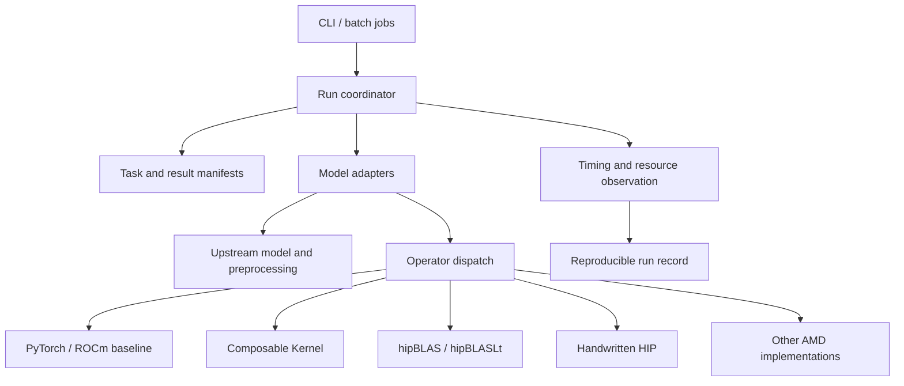

# FireProt architecture

Status: Rust framework migration validated, 2026-10-05. See the
[acceptance audit](rust-acceptance.md). Model adapters retain separate scientific
contracts; this is not a universal API for every folding model. The historical
measurements below remain model-specific.

## Maintained ownership

| Layer | Current owner | Integration status |
| --- | --- | --- |
| Typed requests, cycle semantics and operator selection | `fireprot-core` | Rust; shared Python dispatch uses the Rust registry |
| Source/weight/resource preflight, worker lifecycle and GPU isolation | `fireprot-runtime` | Rust; Protenix, AtlasFold and OpenFold3 workers connected |
| Output acceptance and numerical comparison | `fireprot-validation` | Rust; output bundles, NPY/NPZ, alignment and confidence checks |
| User entry point | `fireprot-cli` | Rust; Protenix native/FireProt, AtlasFold native/chunked/HIP/fused HIP, native and opt-in strict-FP32 HIP OpenFold3 (N1000/N1536 exact-array acceptance passed) |
| Timing and paired comparison | Rust runtime/validation composed by `fireprot-cli` | Complete invocation measurement, archive collection, paired scheduling, declared treatment checks and model-specific numerical gates; validated installed workflows; timing scopes remain explicit |
| In-process operator policy boundary | `fireprot-bridge` | CPython stable C ABI; metadata and callbacks only |
| Model execution | `python/fireprot_workers` and independent upstream checkouts | Explicit PyTorch boundary; supported variants listed in README |
| Native build identity, dependency inventories and cache transactions | `fireprot-runtime` via `fireprot-bridge` | Maintained Torch and standalone HIP loaders use Rust |
| AMD kernels and tensor glue | `kernels/amd`, `python/fireprot` | Rust build services and pinned artifact loaders; root Python imports use a small compatibility shim |

AtlasFold N1000 native output migration passes exactly. Its chunked/HIP/fused HIP
routes also pass exact public-output parity at N1000 and N1536. OpenFold3 N1000
with explicit strict deterministic execution now passes exact native parity under
Rust supervision. Legacy default-mode comparisons remain unpassed after variation
between unchanged native runs; see [deterministic validation](openfold3-determinism.md). Protenix Mini-default native and
FireProt workers now pass existing coordinate/summary gates at N1000 and N1536.
Their full confidence arrays are retained and shape/finite-value checked; this
does not imply bitwise native/accelerated array equality.
AtlasFold schema 3 also binds retained input bytes to the request and verifies
every sample's atom14/CIF correspondence in Rust, including relocated archive
replay. See [structure acceptance](cif-validation.md).
Launch records now bind the executable, declared worker inputs and effective
environment; final reports retain independently verified physical device mapping.
See [execution provenance](execution-provenance.md) for its remaining environment
coverage limits. See [migration gates](rust-migration.md), [running](rust-running.md), and
[operator bridge](rust-operators.md). Historical benchmark Python remains for
reproduction; it is not the target owner of new framework policy.

## Historical operator implementation

The pre-migration implementation used `fireprot/ops`, `fireprot/backends/amd`, `fireprot/adapters/protenix` and `fireprot/validation`. Those Python boundaries now live under `python/fireprot`; Rust owns shared policy and maintained validation. Historical reproduction tools remain under `benchmarks/protenix`. The independent Protenix checkout exposes `fireprot` choices for triangle multiplication and triangle attention while retaining its upstream torch defaults.

FP32 inference paths are promoted on gfx90a for measured 124-token, exact 1,000-token, and opt-in exact 1,536-token Mini workloads. Short triangle multiplication replaces the upstream chunked inference path with a direct update while preserving in-place aliasing. Long triangle multiplication normalizes once, uses HIP sigmoid-and-pack kernels to produce contiguous channel-first projections, contracts them with library BMM, and fuses unpacking with output LayerNorm. The previous chunked contraction and its fusion callbacks remain as a diagnostic fallback. Triangle attention uses PyTorch ROCm memory-efficient SDPA, makes the Protenix head-last triangle bias contiguous, limits its outer batch workspace to 64 rows, and omits an implicit all-ones pair mask. Handwritten HIP kernels specialize contiguous 128-wide pair LayerNorm, fuse channel-first layout conversion with pair LayerNorm, and fuse gated activation epilogues. The long capability set includes the measured 244,000-, 256,000-, and 1,000,000-row LayerNorm calls and the exact `[1000,1000,128]` gated transition. The measured comparisons select hipBLAS at process start. The registry and runtime hooks fall back to native behavior for every unmatched signature or unavailable extension build.

For the exact unmasked 1,000-token signature, CK Tile QRKSVS attention is now promoted with M128/N64 tiles, four wave64 warps, and FP32 computation. It emits head-last storage and is gated on exact QKV strides, shape, dtype, device, pointer alignment, inference mode and the measured CK version. Its complete operator time is 32.711 ms versus direct SDPA's 36.35–36.36 ms. A reverse-order five-repetition model comparison improves 13.120 to 12.580 seconds (1.043x), with unchanged peak allocation. Lazy compilation uses a source/header/compiler fingerprint and a process lock. Direct SDPA remains the fallback and explicit masks retain chunked SDPA. See [CK Tile results](protenix-ck-tile.md). The preceding generic CK header-patch experiment remains outside model dispatch.

For the opt-in N1536 bucket, a separate exact-sequence CK instantiation now
uses M128/N32/W4 and disables query/key/output-row padding only because
1536 divides its sequence tiles exactly. The N1000 padded kernel is kept.
The C ABI rejects other shapes and the existing Python capability checks
and SDPA fallback apply. A same-source Mini-default FP32 C4/S1 comparison
improves warm model time from 36.975 to 31.441 seconds (1.176x), with
unchanged peak allocated memory and passing same-seed coordinate/confidence
gates. `FIREPROT_ENABLE_CK_EXACT1536=0` restores SDPA. The separate two-GCD
experiment remains disabled after full-model regression; it is not a
promoted execution strategy. See [N1536 evidence](protenix-long1536.md).

The complete adapter contract described below has not yet been implemented as a stable public API. The current Protenix bootstrap is the first integration seam from which that API will be extracted after a second model is studied.

The long packed triangle path now defaults to 64-row vectorized HIP sigmoid packing and a fused gated residual update. Same-source Mini FP32 C4/S1 comparisons improve warm model median 10.759 to 10.465 seconds at N1000 and 31.524 to 30.096 seconds at opt-in N1536, with unchanged peak allocated memory and passing coordinate/confidence checks. `FIREPROT_ENABLE_TRIANGLE_VECTOR=0` restores the previous implementation. See [validation](protenix-triangle-vector-probes.md#same-source-model-validation).

Packed output LayerNorm now uses vector global accesses and a subgroup reduction that retains the old channel pairing. Five-repetition same-source model comparisons improve N1000 from 10.466 to 10.360 seconds and N1536 from 30.237 to 29.859 seconds, with unchanged peak allocation and passing prediction comparisons. `FIREPROT_ENABLE_VECTOR_PACKED_NORM=0` restores the previous LayerNorm. The naive reordered reduction was rejected for low-variance disagreement. See [validation](protenix-packed-norm-vector.md#same-source-model-result).

## 1. Scope

FireProt targets protein structure **inference on AMD GPUs**. It should reproduce upstream model semantics and reduce latency or resource use only where measurements support an optimization. Model adapters own model-specific scientific behavior. The framework owns configuration, resources, execution, observation, and validation. Optimized operators must be independently selectable, reversible, and testable.

Compatibility is a capability matrix, not a promise that every model accepts the same inputs, weights, or accuracy metrics. Protenix, OpenFold, and ESMFold have different preprocessing and inference paths. Each adapter pins and checks its actual upstream source; a model name alone does not define a contract.

## 2. Layers and dependency direction



Framework entry points call adapters; adapters call upstream implementations. Operator implementations must not depend on model names. Shared data structures describe tasks, artifacts, capabilities, and timing, without forcing model-internal feature tensors into a cross-model ABI.

The latest N1000 specialization retains sequence-tail masking while overriding bias access alignment to four FP32 elements, with M128/N32/W4 tiles. Same-source warm Mini-default C4/S1 model median improves 12.615 to 10.745 seconds (1.174x), with unchanged peak allocation and passing output comparisons. It is the default in the validated exact bucket; `FIREPROT_ENABLE_CK_VECTOR_BIAS1000=0` restores the preceding CK implementation. See [validation](protenix-ck-vector1000.md).

## 3. Repository boundaries

The maintained Rust workspace has five crates with explicit responsibilities:

```text
crates/
  fireprot-core/        # Requests, model semantics, protocol, operator policy
  fireprot-runtime/     # Processes, devices, provenance, native build/cache services
  fireprot-validation/  # Output acceptance, numerical and structural comparisons
  fireprot-cli/         # User commands and exit status
  fireprot-bridge/      # CPython metadata/callback ABI, no tensor ownership
python/fireprot_workers/ # Pinned upstream invocation and tensor serialization
python/fireprot/        # Upstream adapters, tensor glue, bridge loading
kernels/amd/            # Maintained HIP/CK sources
fireprot/__init__.py    # Import shim for upstream and historical entry points
configs/                # Explicit requests and deployment profiles
tests/                  # Contract, numerical, worker and GPU integration checks
provenance/             # Versioned evidence; generated predictions stay excluded
benchmarks/             # Historical reproduction tools during migration
```

Maintained tensor glue now lives under `python/` and native sources under
`kernels/amd/`. A root import shim preserves upstream imports; historical
benchmark source paths are updated through an explicit relocation map. `provenance/layout_path_map.json` records every moved
file and its before/after hash; see [layout](repository-layout.md). Rust core must remain independent of Torch and host process APIs;
the runtime owns process/device/build policy, and the CLI composes those services.
The bridge receives metadata and invokes local callbacks without copying tensors.

The CLI separates typed command parsing, result presentation, inference setup,
archive collection and host I/O/signal wiring. It composes public crate interfaces;
request, process, operator and validation policy stay in their owning crates.
See [CLI design](cli-design.md).

Deployment should build and validate native artifacts before inference. Rust now publishes verified cached Python extensions with `publish-kernel` and
checks pinned artifacts with `verify-kernel`. The AtlasFold mask/bias loader can
accept that artifact through the bridge using actual runtime compatibility.
Compiler dependency scans belong to build acceptance; published-artifact loading
checks the manifest, receipt and library without reopening build inputs. Rust now orchestrates the experimental Torch compiler process, including staging,
timeout and diagnostics. Maintained Torch and standalone C ABI loaders now use the shared guarded compiler
service. Typed C ABI deployment bundles now cover CK attention and hipBLASLt,
with package-specific ABI revisions and preserved schema-1 Python compatibility. See [Torch loader
ownership](torch-loaders.md) and [direct HIP builds](hip-builds.md). See [published kernel artifacts](kernel-artifacts.md).

Keep `Protenix/` as an independent upstream checkout. Other upstream implementations should follow the same independent-source approach. Keep adapters and local patches in the top-level repository. When an upstream edit is unavoidable, record the baseline commit, patch, and license. Do not copy upstream source into the shared core.

## 4. Model adapter contract

Each adapter should expose an identifier, version, supported upstream version range, `capabilities()`, `validate(request)`, `prepare(request)`, `load(weights, device)`, `predict(prepared, run_config)`, and `collect(raw_output)`. Implementations may combine internal stages, but must report which stages were actually measured. The common entry point must not assume that every model has MSA, templates, diffusion, recycling, or the same confidence head.

A task manifest should record input paths and hashes, model and weight identity, model-specific parameters, random seeds, dtype, device, requested operator backend, output directory, and cache policy. Capabilities should describe supported molecular inputs, chain counts, MSA/template/ligand features, dtypes, device requirements, and replaceable operator sets. Reject unsupported combinations before execution with a clear error.

A result manifest should record coordinate artifacts and formats, native confidence artifacts, stage timings, peak GPU memory, operator implementations actually used, fallback reasons, input/weight/code versions, and the runtime environment. Preserve native model results. Compare models only with explicitly defined common metrics; native confidence scores are not automatically comparable.

`prepare` may return a model-private opaque object or traceable files. Only genuinely shared metadata, such as sequences, chain identities, and MSA/template provenance, belongs in the common schema. ESMFold need not imitate Protenix's feature dictionary.

## 5. AMD operator layer

Replace operators at explicit PyTorch call boundaries. Start with a PyTorch/ROCm reference and fallback for each operator; then evaluate CK, hipBLAS, hipBLASLt, or custom HIP implementations. Select targets from real profiling and remeasure whenever the model, shape, dtype, or hardware bucket changes.

Each operator entry point must define its mathematical expression, tensor layouts and strides, shape range, dtype, accumulation precision, mask and broadcasting semantics, determinism requirement, workspace, output format, and error tolerance. Dispatch depends on these capabilities and device properties. Record the selected backend explicitly; never silently change model semantics. Validate each GPU architecture, ROCm version, and library version separately.

Fresh Mini-default 1,000-token measurements put the recycled Pairformer trunk at 41.530 seconds of a 45.350-second native model median. Native triangle attention takes 29.468 seconds and triangle multiplication 12.505 seconds. The promoted long attention, packed multiplication, LayerNorm, and transition paths reduce those stages to 7.085 and 3.914 seconds and the Pairformer boundary to 12.456 seconds. Model median is 13.501 seconds (`3.359x`), peak allocated memory is 74.59% lower, and peak reserved memory is 67.46% lower. These facts are specific to one exact shape and must not be generalized to other long lengths without measurement. Packed contraction uses more local temporary storage than chunking; the unchanged full-model allocated peak at 1,000 tokens does not justify unrestricted larger buckets.

The historical 124-token matrix has 57 FP32 BLAS signatures: hipBLAS wins the dominant signature, while process-wide CK wins five smaller signatures and rejects fifteen. A direct CK wrapper supports 29 signatures and wins only the eight-call OuterProductMean `124x64 @ 64x32` bucket. Its isolated advantage over hipBLAS is about 30.70 us per inference and did not improve end-to-end medians, so the route is an explicit experimental opt-in. A long-sequence inventory now covers 62 FP32 dimension signatures; process CK supports 48 and direct CK 31, with no dominant projection improvement over hipBLAS. The promoted packing kernels are handwritten HIP. Triangle attention is now the largest measured stage, and larger buckets need explicit workspace and numerical validation.

Handwritten HIP is a first-class backend. Static, CK-style kernels are appropriate when the semantic operation has a stable shape and a library call cannot fuse the surrounding work. The channel-first LayerNorm path consumes the exact `[124,124,128]` logical shape with `[124,1,15376]` stride produced by triangle multiplication and emits a contiguous tensor while applying normalization, scale, and bias in one kernel. The current extensions compile lazily into `runtime/torch_extensions`, fingerprint their source and ROCm/PyTorch versions, and fall back to native code. The direct CK extension is isolated from the handwritten HIP extension so a version-specific internal ATen CK build failure cannot disable promoted paths. Future packaged builds should precompile architecture-specific artifacts while preserving the same capability predicates.

Recycle count belongs to the model adapter policy because it changes model execution semantics. Operator acceleration must preserve the requested count. Approximate early exit may be added only as an explicit request with a separately versioned quality policy, independent validation set, convergence signal, and recorded exit decision.

The operator library may contain many implementations, but should expose a small, stable public interface. Build benchmark records indexed by operator, shape/layout/dtype, GPU architecture, and backend. Enable an optimization only for validated combinations; otherwise fall back to PyTorch. Record operator package versions and build flags.

## 6. Validation and performance

1. **Contract validation:** input capability checks, missing-weight/dependency behavior, and complete result manifests.
2. **Numerical validation:** compare reference and optimized operators at fixed inputs and random states. Include non-contiguous tensors, boundary shapes, masks, multiple dtypes, and extreme values. Define tolerances per operator.
3. **Model validation:** compare end-to-end runs with the same model, weights, input, cycle/recycle count, steps, samples, seed, preprocessing, and cache conditions. Record coordinate and native-confidence differences. For stochastic models, use repeated-run distributions instead of promising bitwise identity.
4. **Performance validation:** report cold and warm start, preprocessing/ESM, model load, major model stages, end-to-end latency, and peak GPU memory separately. Synchronize GPU timing; record warmup, repetitions, concurrency, physical device, GPU model, and ROCm/PyTorch/library versions. Check device state before launch and continuously reject a run if another process joins the selected physical GPU.
5. **Dataset limits:** the current eight short-chain examples are a development set. The 1,000-token input is a performance-only case without an experimental-coordinate mapping. It establishes throughput and native agreement for one exact bucket, not accuracy or generalization. Structural metrics for cases with mappings must use `coordinates[mask]` in `gt_mapping.npz`. Add untouched evaluation cases and more long-chain/complex benchmarks.

## 7. Historical pre-migration stages

This table preserves earlier milestones. Current Rust ownership and acceptance
limits are listed at the start of this document and in `docs/rust-migration.md`.

| Stage | Status | Deliverable and acceptance |
| --- | --- | --- |
| A: Protenix baseline | Implemented for the Mini/124-token and exact Mini/1,000-token matrices | Repeated timing on fixed configurations and hardware; manifests include versions, cache state, stage timings, and peak memory; compare against the current native CLI |
| B: Minimal framework | Partially implemented | Registry, AMD backend boundary, Protenix bootstrap, validation, and measurement exist; the stable task/result coordinator API remains to be extracted |
| C: First AMD operators | Implemented for exact gfx90a FP32 signatures | Short and long triangle paths, short and long contiguous pair LayerNorm, channel-first pair LayerNorm, and short and long gated epilogues have capability checks, tests, native fallback, numerical gates, and measured end-to-end impact |
| D: Additional models | AtlasFold monomer opt-in implemented; other adapters pending | AtlasFold plus AtlasLM-3B has a pinned native runner, version/capability gates, bounded-memory reference, HIP mask/bias path, complete-output checks, and manifests; a shared coordinator API remains future work |
| E: Operator expansion | Active for long-sequence attention and larger buckets | Short and long BLAS inventories, packed triangle contraction, efficient attention, and recycle HIP kernels exist; extend CK, hipBLAS, hipBLASLt, and HIP implementations where measured shapes and repeated comparisons justify them |

Preserve source, weight, and input provenance throughout. Establish correctness before reporting speed. Stage D's order can change with source and weight availability or user priorities.


## Latest triangle projection implementation

The exact gfx90a FP32 N1000 and opt-in N1536 packed triangle paths now use
handwritten MFMA dual projection with shared input/weight tiles and fused
sigmoid/channel-first output. Capability checks retain the preceding path
for unsupported tensors or biased projections. The fixed C64/K16 kernel
preserves precision and cycle count. Same-source warm Mini-default C4/S1
model comparisons measure 10.370 to 9.932 s (N1000, 1.044x) and 29.930 to
28.916 s (N1536, 1.035x), with unchanged allocated memory and passing output
checks. `FIREPROT_ENABLE_DUAL_PROJECTION=0` disables this increment. See
[implementation and evidence](protenix-dual-projection.md#same-source-model-comparison).


The subsequent C128/R128/K16/W8 dual-projection specialization writes logical
`[128,N,N]` output with channel stride `N*N+128`. The existing hipBLAS BMM
consumes that padded batch directly. It is now the default within the
validated dual-projection paths after same-source warm-model gains of
9.936 to 9.884 s (N1000, 1.005x) and 28.835 to 28.413 s (N1536, 1.015x),
with unchanged peak allocation and passing prediction comparisons.
`FIREPROT_ENABLE_TILED_DUAL_PROJECTION=0` restores C64/R64, while
`FIREPROT_ENABLE_DUAL_PROJECTION=0` disables both implementations. See
[tiled projection evidence](protenix-dual-tiles.md#same-source-model-comparison).

The validated long self-attention preparation hook fuses three FP32 QKV
projections and Q scaling with handwritten MFMA HIP, emitting the exact
head-last strides consumed by CK. It accepts identical tensor regions produced
by chunking and the model's FP32 autocast context; low-precision autocast and
unsupported calls use native preparation. Same-source warm-model comparisons
measure 9.919 to 9.745 s (N1000, 1.018x) and 28.519 to 28.127 s (N1536, 1.014x),
with unchanged allocated memory and passing prediction comparisons.
`FIREPROT_ENABLE_QKV_PROJECTION=0` disables this increment. N1536 retains its
length opt-in. See [QKV model evidence](protenix-qkv-projection.md#same-source-model-comparison).

### AtlasFold fused pair backend

The explicit AtlasFold `hip-fused` route combines model-specific dispatch in
`fireprot/adapters/atlasfold/runtime.py` with model-neutral HIP softmax and
BF16 transpose kernels in `fireprot/backends/amd/pair_fusions.py` and `csrc/`.
It preserves native physical BLAS operand layouts and BF16 rounding boundaries.
The measured Torch/HIP version is part of the softmax capability contract.
Unsupported calls retain upstream methods; unavailable builds use bounded
native attention and original multiplication. Source hashes and route counts
are captured per request. See `docs/atlasfold-performance.md` for exact scope,
paired measurements, numerical validation, and experimental follow-ups.


The AtlasFold fused route additionally packs already-scaled Q/K/V BF16 bits
into the native physical BLAS operand layouts. Q and V are contiguous in
`[1,N,4,N,32]`; K has contiguous physical `[1,N,4,32,N]` storage. The native
Q scaling, QK/PV contractions, probabilities, gates, and projections retain
their arithmetic. This path is restricted to the validated gfx90a N1024 and
N1536 buckets and included in the extension and request source fingerprints.

## Independent Linux deployment

`fireprot-runtime::installation` owns selection, copying, hashing and atomic
publication of the framework installation. The CLI composes this service through
`install` and `verify-installation`. Model-specific Python environments remain
separate external dependencies; generated execution profiles identify them and
point all framework code/tools at the installation. Binary input hashes and an
exact installed file inventory support independent verification. This does not
replace model/environment provenance checks. See [installation](installation.md).

## Explicit environment content identity

`fireprot-runtime::environment_inventory` captures named file/tree inventories and
accepts independently pinned manifest bytes. `ExecutionRecord` composes this
optional contract with existing worker/tool/source identities and rechecks it before
Start and before final output acceptance. Python workers do not own inventory or
acceptance policy. `capture-environment` exposes the Rust capture operation; profiles
select its result explicitly. Inventory coverage must be audited against actual
import roots and native dependencies. See [scope and cost](environment-inventories.md).

## Prediction structures

`fireprot-validation::structure` owns strict single-model prediction CIF parsing,
atom identity and Protenix coordinate/confidence comparison. Current output
bundles explicitly bind original sample indices to upstream-written structures.
Rust acceptance checks those files after supervisor hash verification. The worker
transport remains version 1; prediction content is schema 2. Historical schema 1
archives remain readable with their original guarantees. See
[CIF validation](cif-validation.md) for model-specific checks and limitations.

## Run-local upstream scratch files

The CLI selects the fresh output directory as every worker's working directory;
the supervisor creates it before recording launch identity. This keeps upstream
relative feature files scoped to one request. Mini-ESM uses that directory for
its original ESM2-3B featurizer, while Rust requires all three checkpoint roles
and validates retained FP32 language-model inputs. Model glue checks that actual
features match the freshly generated tensors. See [Mini-ESM](protenix-mini-esm.md).

## Ordered batch execution

`fireprot-runtime::batch` owns pinned request/profile snapshots, duplicate-output
checks, sequential job transitions, cancellation and a shared deadline. The CLI
validates execution-profile schemas before starting the coordinator and supplies
the existing supervised single-job service. Every successful job retains its own
accepted archive. Failure, cancellation and timeout stop subsequent launches;
remaining jobs are explicitly reported as skipped. This replaces the maintained
Python smoke scheduler; historical scripts remain under `.agents/legacy_*` with
recorded path/hash provenance. See [batch inference](batch-inference.md).
