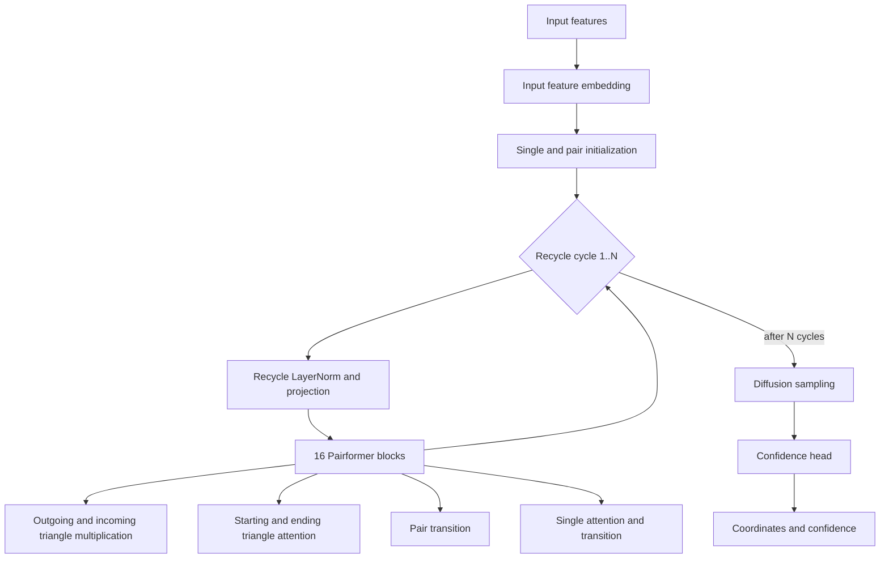

# Protenix AMD performance report

Status: measured development result, 2026-10-02.

## Scope and provenance

This report covers Protenix Mini-default v0.5.0 on AMD Instinct MI250X/MI250 gfx90a GCDs 6 and 7. The input is `cases/1izr_L124/input.json`, a 124-token single-chain development case. Results apply to FP32 inference with seed 101, one sample, warm in-process caches, no MSA/template search, TF32 disabled, four recycling cycles, and one or five diffusion steps.

Source identities:

- measured FireProt commit: `773999ae404c561309391fa72902641e5be3fb95`
- direct CK candidate commit: `619db00e21d942f3ff4f3d202b0b02b93bfe5695`
- channel-first LayerNorm commit: `47850407da303a21ec84a6327300424082ac4875`
- independent Protenix integration commit: `316f5778e80965015a80339de632291f1abbb7f5`
- Protenix upstream baseline: `d3b4db6a121dd4584edd85e93744239325a2b72e`
- profiler SHA-256: `511213a16ed1e820e0976cec4903638f589c2d1d3bdd657c26bbd14e13ff7b4a`
- benchmark configuration SHA-256: `ee8de5227f50f1f9348fde4980127cc81ad20bfc898a8281dd87554accaabffa`

The runtime used Python 3.12.13, PyTorch `2.12.0a0+git78258b9`, and HIP `7.14.60850`. Each latency result used five warmups and thirty measured repetitions. GPU events exclude preprocessing and serialization.

Every accepted run passed both an exclusive-device preflight and continuous `amd-smi process --json` monitoring at one-second intervals. The C4/S1 pair ran on physical GCD 6 and the C4/S5 pair ran on GCD 7. C4/S1 and C4/S5 were executed concurrently on separate GCDs; each native/FireProt comparison used the same GCD. Other GCDs on the host may have been active.

## Model architecture and execution flow

Mini-default uses `c_s=384`, `c_z=128`, sixteen Pairformer blocks, one MSA block, and an eight-block diffusion transformer. The measured path disables MSA and templates, so its dominant flow is:

Each Pairformer block performs two triangle multiplications, two triangle attentions, a pair transition, and single-state work. Recycling repeats the complete sixteen-block trunk. The confidence head also contains Pairformer work, so raw `PairformerStack.forward` event counts include one post-recycle confidence stack; the `get_pairformer_output` stage is the clean recycle-trunk boundary.

On the native C4/S1 run, `get_pairformer_output` took 399.94 ms of the 457.86 ms model median. This makes the recycle trunk the dominant optimization target for this bucket. The result does not establish the same split for Base weights, longer sequences, complexes, or other models.

## Promoted implementation set

| Operation or policy | Implementation | Promoted capability |
| --- | --- | --- |
| Process BLAS | PyTorch `hipblas` preference | Exact measured Mini-default, 124-token, FP32, gfx90a bucket |
| Triangle multiplication | `amd-short-sequence-torch` | gfx90a, FP32, inference/no-grad, contiguous unbatched pair tensor, `N <= 256`, in-place-safe Protenix path |
| Triangle attention | `amd-gfx90a-efficient-sdpa` | gfx90a, FP32, QKV `[124,4,124,32]`, observed strided layout and two additive bias shapes |
| Pair LayerNorm | `amd-gfx90a-hip-layernorm-f32-c128` | gfx90a, FP32, inference/no-grad, contiguous 15,376 by 128 rows, epsilon `1e-5`, supported affine forms |
| Channel-first pair LayerNorm | `amd-gfx90a-hip-layernorm-f32-c128-channel-first` | gfx90a, FP32, inference/no-grad, exact `[124,124,128]` shape and `[124,1,15376]` stride, full affine parameters, epsilon `1e-5` |
| Gated transition epilogue | `amd-gfx90a-hip-transition-f32-c128` | gfx90a, FP32, contiguous `[124,124,128]`, expansion factor four |

The new recycle-trunk operations are small handwritten HIP kernels with CK-style static specialization:

- LayerNorm assigns one wave64 to each 128-value row, processes two values per lane, and places four waves in a block. Separate kernels cover full affine, scale-only, and no-affine forms.
- Channel-first LayerNorm tiles the triangle-contraction output in LDS, reads the physical `[128,124,124]` storage with coalesced accesses, and writes contiguous `[124,124,128]` output while applying normalization, scale, and bias.
- The transition keeps its three linear layers library-backed and fuses `SiLU(activation) * gate` into a vectorized `float4` kernel.
- Sources compile lazily through the PyTorch C++ extension loader into excluded `runtime/torch_extensions/`. A missing compiler, unsupported ROCm build, unsupported signature, training/autograd call, or disabled extension falls back to native Protenix.

Triangle attention uses ROCm memory-efficient scaled dot-product attention with an outer batch chunk of 64. Triangle multiplication selects the direct non-chunked update for the validated short sequence while preserving Protenix's in-place result behavior.

## Complete observed BLAS call matrix

A C4/S1 operator trace contained 57 distinct FP32 `mm`, `bmm`, and `addmm` signatures, 3,132 calls, and 132.926 ms of summed operator device time. Every signature was benchmarked in isolated processes with `auto`, `hipblaslt`, `hipblas`, and `ck`; all four processes passed continuous GPU process monitoring.

| Observed signature | Calls | Auto median | hipBLAS median | CK median |
| --- | ---: | ---: | ---: | ---: |
| `mm 15376x128 @ 128x128` | 1,588 | 50.242 us | 35.842 us | 53.442 us |
| `mm 15376x128 @ 128x512` | 144 | 88.963 us | 82.242 us | 145.925 us |
| `bmm 128x124x124 @ 128x124x124` | 144 | 54.722 us | 68.322 us | 68.162 us |
| `mm 15376x512 @ 512x128` | 72 | 85.282 us | 89.923 us | 143.844 us |
| `mm 15376x128 @ 128x4` | 144 | 50.082 us | 34.721 us | 44.802 us |

With the locked requirement of at least 1.10x median speedup and no p95 regression against auto, the per-signature selector retained auto for 11 signatures, selected hipBLAS for 41, and selected CK for five. CK supported 42 of 57 signatures and rejected 15. The five CK-selected signatures account for a modeled 313.92 us advantage over hipBLAS across the observed call counts; four have only a 0.32 to 3.76 us median advantage per call. A custom dispatcher could consume that small remainder, but it has not passed an end-to-end gate.

The dominant 1,588-call matrix multiply is 1.402x faster with hipBLAS than auto and slower with CK. The isolated matrix projects 37.639 ms savings from global hipBLAS and 38.992 ms from an ideal per-signature hybrid. These are projections from isolated medians. The end-to-end measurements below validate only the global hipBLAS policy plus the promoted operator paths.

Global CK is rejected for this bucket. CK remains a candidate for future per-signature kernels, BF16 buckets, and shapes from other model adapters.

### Direct CK candidate

A separate direct CK wrapper calls the PyTorch HIP `gemm_internal_ck<float>` entry point and is built independently from the promoted handwritten HIP extension. Across the same 57 observed signatures, it supported 29 and won only `mm 124x64 @ 64x32`. That signature occurs eight times in the OuterProductMean projections. Its medians were 47.34 us for auto, 30.22 us for hipBLAS, and 26.39 us for direct CK. The isolated advantage over hipBLAS projects only 30.70 us per inference.

Same-seed output validation passed, but formal 30-repetition A/B runs did not improve model medians: C4/S1 changed from 321.03 to 321.68 ms and C4/S5 from 390.06 to 396.30 ms. Direct CK is therefore not promoted. It requires `FIREPROT_ENABLE_CK_OPS=1`, and `FIREPROT_DISABLE_CK_OPS=1` overrides the opt-in. The wrapper uses an internal ATen API, so compilation failure or a version mismatch records the error and returns to the native route without disabling other FireProt kernels.

## End-to-end performance

| Workload | Metric | Native | FireProt | Native / FireProt |
| --- | --- | ---: | ---: | ---: |
| C4/S1 | model median | 457.86 ms | 334.48 ms | 1.369x |
| C4/S1 | model p95 | 475.15 ms | 351.86 ms | 1.350x |
| C4/S1 | recycle trunk median | 399.94 ms | 283.01 ms | 1.413x |
| C4/S1 | triangle multiplication median | 195.78 ms | 117.43 ms | 1.667x |
| C4/S1 | triangle attention median | 135.25 ms | 95.96 ms | 1.409x |
| C4/S5 | model median | 530.89 ms | 390.77 ms | 1.359x |
| C4/S5 | model p95 | 564.35 ms | 407.77 ms | 1.384x |
| C4/S5 | recycle trunk median | 402.67 ms | 277.91 ms | 1.449x |
| C4/S5 | triangle multiplication median | 196.78 ms | 116.98 ms | 1.682x |
| C4/S5 | triangle attention median | 135.45 ms | 94.43 ms | 1.434x |

The C4/S1 FireProt run selected the HIP LayerNorm 15,330 times, the fused transition 2,520 times, triangle multiplication 5,040 times, and triangle attention 5,040 times across warmup and measured calls. Shape-gated native fallbacks remained active for other LayerNorm and transition signatures.

## Incremental channel-first LayerNorm result

The current profile exposed 144 LayerNorm calls per model invocation with logical shape `[124,124,128]` and stride `[124,1,15376]`. They are the channel-first outputs of triangle multiplication. The original route materialized a contiguous layout before applying LayerNorm. The new HIP kernel fuses that layout conversion with normalization, scale, and bias.

On physical GCD 7, 25 warmups and 300 operator measurements produced:

| Metric | Native torch | Fused HIP | Native / HIP |
| --- | ---: | ---: | ---: |
| median | 117.48 us | 82.74 us | 1.420x |
| p95 | 118.59 us | 83.38 us | 1.422x |

The maximum operator error was `2.8610e-6` and RMS error was `1.2336e-7`. A C4/S1 same-seed prediction comparison passed the locked `1e-3` coordinate and confidence gates: aligned coordinate RMSD was `8.5654e-5 A`, maximum coordinate delta was `4.8828e-4 A`, and maximum confidence delta was `1.5259e-5`.

The first formal 30-repetition C4/S1 A/B improved model median from 327.57 to 321.47 ms, a 6.10 ms reduction (`1.019x`), and p95 from 335.06 to 327.17 ms (`1.024x`). Pairformer median improved from 268.09 to 264.58 ms (`1.013x`). All runs passed continuous process monitoring with no external PID.

C4/S5 was sensitive to execution order. A disabled-then-enabled run changed median from 387.64 to 389.74 ms while improving p95 from 418.81 to 408.41 ms. A second enabled-then-disabled run changed median from 387.16 to 384.21 ms while p95 changed from 408.72 to 414.74 ms; its Pairformer median improved from 268.91 to 264.58 ms. The exact operator speedup is established, and the path remains capability-gated with native fallback. The evidence does not establish a stable incremental C4/S5 whole-model speedup.

The path is enabled for its exact validated capability. `FIREPROT_DISABLE_CHANNEL_FIRST_LAYERNORM=1` disables it for diagnosis or A/B measurement.

## Peak memory

| PyTorch peak metric | Native maximum | FireProt maximum | Difference |
| --- | ---: | ---: | ---: |
| Allocated | 850,018,304 B | 757,955,584 B | -92,062,720 B (-10.83%) |
| Reserved | 1,029,701,632 B | 920,649,728 B | -109,051,904 B (-10.59%) |

The result combines the selected BLAS library, short-sequence triangle path, chunked efficient attention, and recycle HIP kernels. It is not an isolated memory attribution for any one operation.

## Numerical validation

Native and FireProt outputs used the same weights, input, seed, FP32 dtype, cycle count, diffusion steps, sample count, preprocessing, and cache policy. Both comparisons ran on the same physical GCD as their performance pair.

| Workload | Atoms | Aligned coordinate RMSD | Maximum coordinate delta | Maximum confidence delta | Gate |
| --- | ---: | ---: | ---: | ---: | --- |
| C4/S1 | 945 | 1.1821e-4 A | 9.7656e-4 A | 2.3842e-7 | pass |
| C4/S5 | 945 | 5.8673e-5 A | 4.7112e-4 A | 2.6703e-5 | pass |

The locked coordinate and confidence thresholds are `1e-3`. Experimental-coordinate utilities use only `coordinates[mask]` from `gt_mapping.npz`; the input `reference` conformation is not treated as experimental ground truth.

## Recycle-cut experiment

Reducing the cycle count is an approximate model policy. It changes the number of Pairformer applications and is not an operator-equivalent acceleration. The default remains C4.

| Cycles | Model median | Recycle trunk median | Speedup vs C4 | Aligned RMSD vs C4 | Max confidence delta vs C4 |
| ---: | ---: | ---: | ---: | ---: | ---: |
| 1 | 123.86 ms | 75.50 ms | 2.700x | 5.760 A | 5.468 |
| 2 | 189.20 ms | 140.30 ms | 1.768x | 2.691 A | 2.000 |
| 3 | 259.57 ms | 210.57 ms | 1.289x | 4.221 A | 2.048 |
| 4 | 334.48 ms | 283.01 ms | 1.000x | reference | reference |

All cycle timings used five warmups and thirty measurements and passed continuous process monitoring. The C1, C2, C3, and C4 aligned RMSDs to the masked experimental mapping were 13.573, 14.282, 13.970, and 14.367 A, respectively. This single development example is not an accuracy benchmark, and the sequence is not monotonic. It cannot justify a fixed lower cycle default or a quality claim.

A future early-exit policy requires an independent evaluation set and a convergence signal measured before the next cycle. It must report the exit distribution, latency distribution, structure metrics, confidence calibration, and failure cases. Until that gate exists, users may request fewer cycles explicitly and should treat the result as approximate.

## Remaining work

1. Capture fresh operator traces for longer token buckets, Base weights, complexes, and the other model adapters before sharing tuning rules.
2. Revisit the 144-call `bmm 128x124x124` triangle contraction. Auto is 13.60 us faster per isolated call than global hipBLAS, but any local override must beat its dispatch cost and improve end-to-end p95.
3. Extend stride-aware kernels beyond the promoted channel-first LayerNorm and evaluate residual epilogues. Keep contraction GEMMs library-backed unless a specialized CK or HIP kernel wins end to end.
4. Add BF16 only after operator and end-to-end distributional validation. Existing evidence does not support promoting it.
5. Implement approximate recycle early exit only after the independent quality protocol above is available.

## Limits

- The eight repository cases are development inputs, not an independent test set. The repeated results above use one 124-token case.
- The BLAS call inventory comes from a C4/S1 FireProt/auto trace with the same model shape. Custom LayerNorm changes non-BLAS operator counts but does not change the listed GEMM dimensions.
- Base weights, longer sequences, complexes, ligands, production diffusion-step counts, BF16/FP16, gfx942, and multi-GPU execution are unmeasured.
- The installed environment does not provide the optional Triton package required by Protenix's `triattention` implementation. FireProt uses PyTorch ROCm efficient attention for the promoted signature.
- Raw manifests, predictions, and profiler traces remain on DiamondHill under excluded `outputs/` paths. Compact machine-readable records are in `provenance/protenix_amd_benchmark.json` and `provenance/protenix_amd_incremental_4785040.json`.
