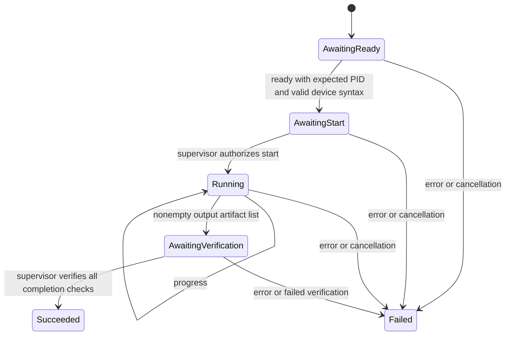

# Model worker protocol

Status: the Rust contracts and state machine are implemented in `fireprot-core`.
Process transport, device probing, filesystem verification and model-worker
integration are still pending. Existing Python workflows do not yet use this
protocol or the Rust operator registry.

## Ownership

The Rust supervisor owns job state and the success decision. A worker owns
upstream model execution and reports observations. A worker cannot report a
trusted isolation result or mark a run successful. Protocol frames must use a
channel separate from upstream model logs; the runtime will enforce frame size,
timeouts, exit handling and cancellation when transport is implemented.

## Event envelope

```json
{
  "schema_version": 1,
  "run_id": "long-1536-seed102",
  "sequence": 0,
  "payload": {
    "event": "ready",
    "device": {
      "worker_pid": 1234,
      "logical_device": 0,
      "pci_address": "0000:93:00.0",
      "architecture": "gfx90a"
    }
  }
}
```

The run ID must match the validated request, sequence numbers start at zero and
increase by one, and unknown envelope/payload fields are rejected. Logical
HIP device zero inside the worker is not an SMI index. The runtime must match
the reported PCI identity independently and verify the child PID before it
authorizes model execution.

## Lifecycle



Wrong version, run ID, sequence, ordering, identity or artifact declarations
permanently fail the session. A terminal session cannot be reopened. A clean
child exit without announced outputs fails. Output paths must be unique and
relative, and SHA-256 strings must be valid; these syntax checks do not replace
runtime containment, file-content, shape/dtype or numerical checks.

`CompletionChecks` is a Rust-only type, not deserializable from worker messages.
Success requires exit code zero, verification of every declared artifact, at
least one isolation sample, no unexpected GPU PIDs, and no monitoring errors.
Only the forthcoming supervisor may construct this evidence after actual checks.

## Operator policy

The Rust registry stores exact operation signatures, including shape, strides,
layout, dtype, architecture, mode, mask, aliasing intent and attributes. It
selects the highest-priority supported implementation, with stable name/version
tie ordering. Missing candidates or failed predicates yield native fallback;
predicate panics reject that candidate. Registration/removal clears decision
caches; explicit runtime-state clearing is required for external policy changes.

The registry is single-owner and requires mutable access for mutation/selection.
The forthcoming in-process bridge supplies synchronization and maps selected
implementation IDs to model-process GPU calls. It must not spawn a subprocess
or serialize tensors for each operator. Python registry replacement remains a
separate, parity-gated integration step.
