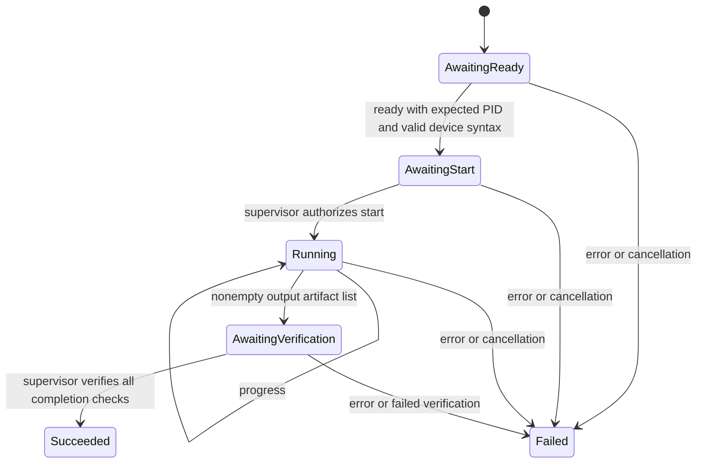

# Model worker protocol

Status: the Rust contracts and state machine are implemented in `fireprot-core`.
The Unix process transport and artifact hashing are implemented in
`fireprot-runtime`. Production device probes, model content validators and
model-worker integration are still pending. Existing Python workflows do not yet use this
protocol or the Rust operator registry.

## Ownership

The Rust supervisor owns job state and the success decision. A worker owns
upstream model execution and reports observations. A worker cannot report a
trusted isolation result or mark a run successful. Protocol frames must use a
channel separate from upstream model logs; the runtime enforces frame size, timeouts, exit handling and cancellation.

## Event envelope

```json
{
  "schema_version": 1,
  "run_id": "long-1536-seed102",
  "sequence": 0,
  "payload": {
    "event": "ready",
    "device": {
      "worker_pid": 1234,
      "logical_device": 0,
      "pci_address": "0000:93:00.0",
      "architecture": "gfx90a"
    }
  }
}
```

The run ID must match the validated request, sequence numbers start at zero and
increase by one, and unknown envelope/payload fields are rejected. Logical
HIP device zero inside the worker is not an SMI index. The runtime must match
the reported PCI identity independently and verify the child PID before it
authorizes model execution.

## Lifecycle



Wrong version, run ID, sequence, ordering, identity or artifact declarations
permanently fail the session. A terminal session cannot be reopened. A clean
child exit without announced outputs fails. Output paths must be unique and
relative, and SHA-256 strings must be valid; these syntax checks do not replace
runtime containment, file-content, shape/dtype or numerical checks.

`CompletionChecks` is a Rust-only type, not deserializable from worker messages.
Success requires exit code zero, verification of every declared artifact, at
least one isolation sample, no unexpected GPU PIDs, and no monitoring errors.
The runtime supervisor constructs this evidence after its host monitor and
artifact/content checks pass.

## Operator policy

The Rust registry stores exact operation signatures, including shape, strides,
layout, dtype, architecture, mode, mask, aliasing intent and attributes. It
selects the highest-priority supported implementation, with stable name/version
tie ordering. Missing candidates or failed predicates yield native fallback;
predicate panics reject that candidate. Registration/removal clears decision
caches; explicit runtime-state clearing is required for external policy changes.

The registry is single-owner and requires mutable access for mutation/selection.
The forthcoming in-process bridge supplies synchronization and maps selected
implementation IDs to model-process GPU calls. It must not spawn a subprocess
or serialize tensors for each operator. Python registry replacement remains a
separate, parity-gated integration step.

## Unix transport and process supervision

`fireprot-runtime::supervisor::run` reserves a new output directory, writes the
validated request, and launches a command without a shell in a dedicated process
group. `FIREPROT_REQUEST` points to the request file, `FIREPROT_OUTPUT_DIR` is the
absolute output directory, and `FIREPROT_WORKER_SOCKET` points to a Unix socket
in a private temporary directory. Workers connect and send newline-terminated
event envelopes. Stdout/stderr go to separate log files.

After independent device verification and a successful initial isolation sample,
the supervisor replies `{"schema_version":1,"command":"start"}` followed by a
newline. Workers must wait for that command before loading/executing models.
The supervisor continues sampling through process exit. Frame size and per-tick
reads are bounded; timeout/cancellation stops the entire process group. The group
is also stopped before artifact verification after a normal parent exit.

Every declared output must resolve inside the output directory and match its
SHA-256. A required Rust content-validator callback must additionally verify the
model's required arrays and metadata. Process exit zero without outputs fails.
Post-launch failures are retained in `supervisor.json`; setup/spawn failures
return an I/O error and may leave the reserved directory for diagnosis. Existing
output directories are never reused.

This layer currently exposes an independent `DeviceMonitor` trait. Its real
HIP/SMI implementation, input/source/checkpoint preflight, numerical validators
and production workers remain integration work. CPU tests use a standard-library
Python fixture as a real child process and an injected host monitor; they do not
establish GPU isolation or full-model parity.
